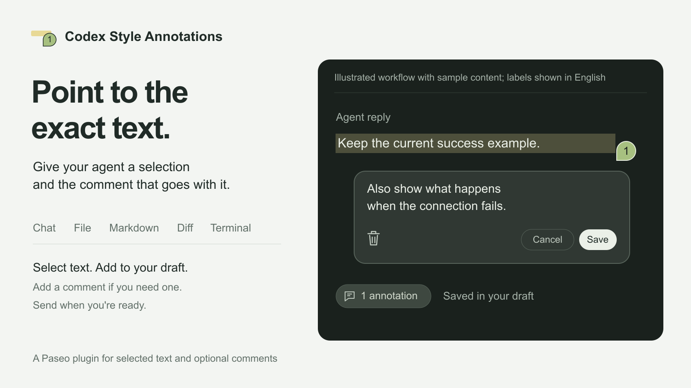

# Codex Style Annotations

[English](README.md) | [Simplified Chinese](README.zh-CN.md)

Attach selected text from a Paseo chat, file editor, Markdown preview, Diff, or terminal to a conversation. Add an optional comment, edit it later, and return to the source when its position is still available.



Version `v0.2.0` adds workspace sources and annotation-type settings to chat annotations.

## Install

Paseo 0.11.4 or later with native plugin Settings support is required. Enable plugins in **Settings > Plugins**. If the original `quote` plugin is installed, disable it before enabling this plugin.

```bash
paseo plugin disable quote
paseo plugin add git:xzthemeofsss/paseo-codex-style-annotations --ref v0.2.0
```

The command installs `v0.2.0`. Skip the disable command if `quote` is not installed. The runtime ID remains `quote-notes`; existing `quote` annotations remain readable, and edits preserve their identity.

## Add and edit annotations

Select text and choose **Add to chat**. For workspace sources, **Add to {chat}** shows the receiving conversation. It defaults to the most recently focused chat in the same workspace. Use the arrow to choose another chat. An open composer is not required.

The annotation appears immediately. Enter a comment or leave it empty. Adding an annotation does not send a message; send it through Paseo's normal composer controls.

For a new comment, **Enter**, **Esc**, or leaving the field saves the text. **Shift+Enter** inserts a line break. Input-method composition does not confirm a comment.

Hover or focus the annotation-count capsule to preview its entries. Click to keep it open. Open an entry's edit card to change its comment or delete the annotation. In that card, **Enter** inserts a line break. Save commits the changes, including with **Cmd+Enter** on macOS or **Ctrl+Enter** elsewhere. Cancel, **Esc**, or clicking outside discards unsubmitted edits.

If a save or deletion is unconfirmed, resolve the error before reloading or disabling the plugin. Retry text is held only in memory. Closing the card does not undo an operation already attempted.

Click a summary entry to return to its source. Source loss does not prevent draft editing or removal. Saved text remains readable.

## Choose sources and language

Open **Settings > Plugins > Codex Style Annotations > Annotation types** to enable or disable chat, file, Diff, Markdown, and terminal capture separately. All five start enabled. Settings belong to the host installation. Turning a type off affects new annotations; saved annotations and chat side questions remain available.

Settings load at startup and are checked again before each addition. Read failures and save conflicts stay visible without resetting saved values.

Settings, the selection toolbar, annotation popovers, and messages follow Paseo's English or Chinese language setting. Other languages use English. Annotations saved in Chinese before this change still open and edit normally.

## Supported sources

| Source | Capture and navigation |
| --- | --- |
| Chat | Selected rendered text and the host's Markdown serialization. |
| File editor | One continuous text range, file path, lines, and document fingerprint. Exact highlighting requires matching content, including unsaved edits. |
| Markdown preview | Rendered text and a file path, without inferred source lines. |
| Diff | One continuous file and side in split or unified layout. Mixed files, sides, headers, and gaps are refused. Reopening a Diff does not verify its original line position. Working comparison refs are mutable. |
| Terminal | Selected text, terminal session, buffer kind, and buffer coordinates. Later output, resizing, closure, or reload can invalidate exact navigation. |

Capture does not use the clipboard or send terminal input. Browser-page capture and side questions from workspace sources are not supported. Very long locator metadata can be refused.

## Read sent annotations and ask side questions

Open a sent annotation-count capsule with a click, **Enter**, or **Space** to read the complete text. Copy an entry with its copy control. **Esc** closes the preview and returns focus. Sent annotations are read only. The complete text includes the comment because Paseo no longer retains it as separate metadata after sending.

Validated pending messages keep the same capsule through confirmation. Unsupported rows and rows shown before the native adapter is ready retain native attachment cards.

For a chat selection, choose **Ask in side chat** and enter a question. The child agent uses the parent's provider, model, mode, and thinking level. It receives the selection, the source message when available, and up to eight recent main-chat turns. Continue in the side panel or open it as a chat tab.

## Data access and compatibility

The plugin runs as trusted code. It reads selections, source context, same-workspace agents and drafts, sent attachments, annotation settings, and recent conversation text for side questions. Annotations use Paseo's native draft store. Sending a draft or asking a side question sends that content through the configured agent provider. Copy controls write to the clipboard.

Native adapters inspect private app interfaces and fetch Paseo's own JavaScript bundles from the same origin. A Paseo update can require an adapter update. The plugin adds no external backend and installs no software at runtime. Disabling it restores native attachment cards without deleting saved annotations.

The chat UI was checked on macOS with Paseo 0.11.4. Isolated browser checks against the installed 0.12.0-beta.3 renderer cover workspace capture, light and dark toolbars, compact layouts, language changes, and pending capsules. These checks do not certify every running client. Complete browser clients and mobile clients have not been independently verified. Mobile platforms use their system selection menu.

## Develop

```bash
npm ci --ignore-scripts
npm run typecheck
npm test
```

The retained tests load native modules from the installed macOS Paseo bundle. Set `PASEO_BUNDLE` to use another bundle. Tests do not install the plugin or send agent messages. Runtime modules come from Paseo, so installation requires no build command or dependency installation.

## Credits and license

This plugin is a fork of [paseo-quote by Chechulin Serhii](https://github.com/keefeere/paseo-quote). The original [MIT license](LICENSE) and copyright notice are preserved.
